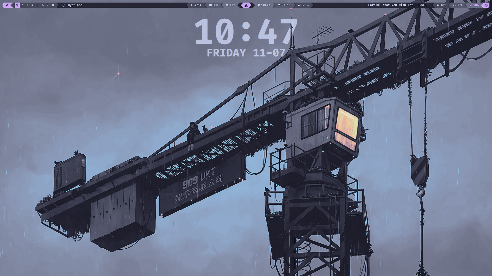
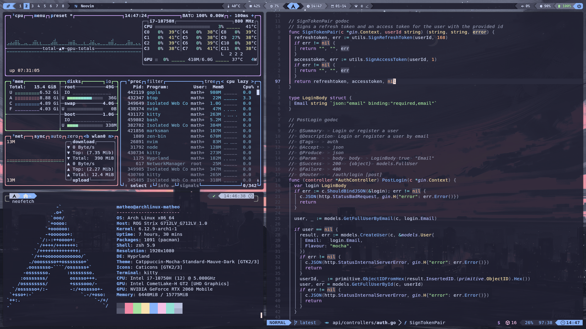
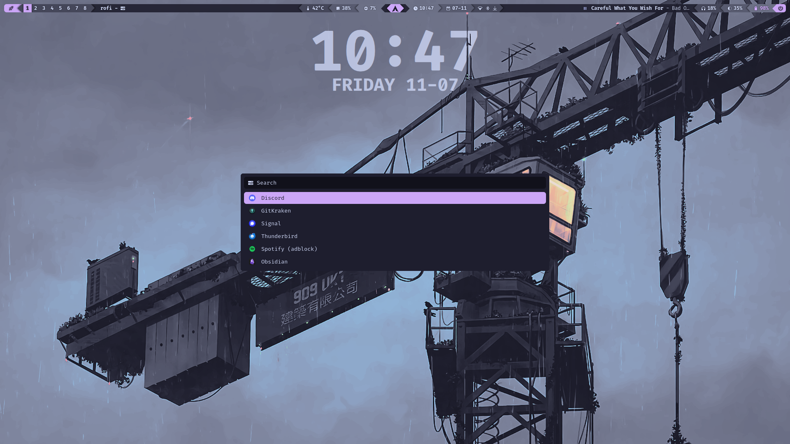

# 🌟 Dotfiles for my Arch Linux Setup

A curated setup for a sleek and efficient desktop experience using Arch Linux and Hyprland.

## 🖥️ System Configuration

- **Operating System:** Arch Linux <small>BTW</small>
- **Window Manager:** Hyprland
- **Terminal Emulator:** Kitty
- **Terminal Tools:** Fastfetch, Btop, Jellyfin-TUI, Lazygit, Starship
- **Shell (bar, launcher, panels, notifications):** Quickshell
- **File Manager:** Thunar

## 📸 Screenshots

### Desktop View



### Development Environment



### Rofi Application Launcher



## Basic setup

### Packages installation

#### Stable/Extra packages
```bash
# Desktop
sudo pacman -S hyprland hypridle hyprlock hyprsunset xdg-desktop-portal-hyprland quickshell
# Terminal & shell
sudo pacman -S kitty zsh zsh-autosuggestions zsh-syntax-highlighting zsh-completions starship neovim git lazygit btop fastfetch bat eza
# Tools used by the Quickshell panels (screenshots, recording, clipboard, media, updates…)
sudo pacman -S grim slurp wf-recorder wl-clipboard cliphist jq curl playerctl zenity pacman-contrib brightnessctl python-numpy python-fonttools
# Network, Bluetooth & audio
sudo pacman -S networkmanager bluez bluez-utils blueman bluetui pipewire pipewire-pulse wireplumber openrgb
# Fonts & icons
sudo pacman -S ttf-firacode-nerd noto-fonts-emoji noto-fonts-cjk papirus-icon-theme qt6ct
# Apps
sudo pacman -S thunar discord signal-desktop obsidian vlc syncthing docker docker-compose
```
#### AUR packages
```bash
paru -S zen-browser-bin spotify jellyfin-tui qimgv-git
```

### Shell
zsh with Oh My Zsh; the config lives in `zsh/zshrc`. Hook it up:
```bash
sh -c "$(curl -fsSL https://raw.githubusercontent.com/ohmyzsh/ohmyzsh/master/tools/install.sh)" "" --unattended --keep-zshrc
echo 'source "$HOME/.config/zsh/zshrc"' > ~/.zshrc
```
Inline suggestions from history (→ accepts, Ctrl+→ one word), syntax highlighting, and a Tab
menu moved through with the arrows.

### Theme
Colours come from one place: `theme/theme.json` (Catppuccin flavor + accent). Switch with
```bash
~/.config/theme/apply.py mocha blue   # flavor: latte frappe macchiato mocha · any Catppuccin accent
```
It regenerates the Hyprland, kitty, btop, starship, fastfetch, zsh and Qt (qt6ct) colours; Quickshell follows live, and the RGB lighting (keyboard, mouse, motherboard headers) is set to the accent with OpenRGB.

## 💡 Usage Permission

Feel free to use, modify, and build upon these dotfiles for your personal setup.
If you do, please credit this repository and include the accompanying LICENSE file in your project.

## 💡 Credits

**Waybar Inspiration & Rofi Scripts :** [Hyprrice by sejjy](https://github.com/sejjy/hyprrice)<br>
**Catppuccin Mocha Wallpaper Collection :** [orangci/walls-catppuccin-mocha](https://github.com/orangci/walls-catppuccin-mocha)<br>
**Favorite Theme :** [Catppuccin (Mocha, Blue/Mauve Accent)](https://catppuccin.com)<br>
